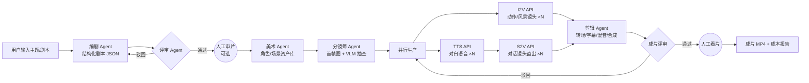

# FastVideo3 产品需求文档（PRD）

| 项 | 内容 |
|---|---|
| 项目名称 | FastVideo3 —— 基于 LangGraph 多智能体的全 API 化短剧/电影视频生成教学平台 |
| 文档版本 | v1.0 |
| 日期 | 2026-08-22 |
| 状态 | 待评审 |
| 前置文档 | 无（本文档为首份产出） |
| 后续文档 | `TDD.md`（技术设计）→ 模块代码 → CI 自检 → 系统联调 |
| 前代项目 | FastVideo2（github.com/Mingyang0018/FastVideo，本地推理单体版） |

---

## 1. 产品概述

### 1.1 背景

前代 **FastVideo2** 已经验证了「主题 → 短剧视频」端到端流水线的可行性（剧本生成 → 语音合成 → 角色/分镜生成 → 图生视频 → 双人同屏 → 拼接成片），但存在四个阻碍其作为教学与产品化载体的根本问题：

1. **代码结构**：3000+ 行单体 `main.py`，无法分模块教学、测试与替换；
2. **转场能力**：仅有"插入风景空镜 + 硬拼接"，无真正的转场动画；
3. **一致性**：角色跨镜头一致性完全依赖提示词，无资产锚定机制；
4. **硬件门槛**：FLUX + Wan2.2-TI2V-5B + MultiTalk 全部本地推理，要求学生自备大显存 GPU，教学无法普及。

与此同时，2026 年两个外部条件成熟：

- **推理 API 化**：视频/图像/语音生成模型均有成熟的 API 服务（阿里云百炼 DashScope、DeepSeek、SiliconFlow、可灵等），一台无 GPU 的笔记本即可调用；
- **多智能体编排标准化**：LangGraph 1.0 已成为生产级有状态多智能体编排的事实标准，其检查点续跑、人工介入、循环重试特性与视频生产流水线天然契合。

### 1.2 产品定位

> **FastVideo3 = 多智能体驱动、全 API 化、零 GPU 门槛的短剧视频自动生成平台，同时是"LLM 应用 + 多智能体系统"课程的生产级教学案例。**

一句话描述：**输入一个主题，输出一部有人物对话、有人物动作、有转场动画的完整短剧视频；全程只调 API，不烧本地显卡。**

### 1.3 设计目标（按优先级）

| # | 目标 | 说明 |
|---|---|---|
| G1 | **教学优先** | 每个模块独立、可单独运行、中间产物可见、可替换（Provider 模式）、可消融对比 |
| G2 | **零 GPU 门槛** | 所有生成类推理走 API KEY；仅 YOLOv8-seg / rembg / FFmpeg 保留本地运行（纯 CPU、秒级、免费） |
| G3 | **生产级架构** | Schema-first + LangGraph 多智能体编排 + 检查点续跑 + 人工审片 + 成本控制 |
| G4 | **效果可演进** | Provider 可切换，随模型 API 升级而升级，架构不动 |

### 1.4 非目标（v1 明确不做）

- ❌ 不自研、不微调任何生成模型（LoRA 训练需本地 GPU，列入扩展期课题）
- ❌ 不以 90 分钟长片为 v1 交付目标（架构支持，路线图为：30 秒微短剧 → 3 分钟短剧 → 剧集 → 长片）
- ❌ 不做实时交互生成、不做视频流式播放
- ❌ 不做多租户 SaaS 计费系统（预留成本台账接口即可）

---

## 2. 目标用户与使用场景

| 用户 | 场景 | 核心诉求 |
|---|---|---|
| 高校/培训机构教师 | 「LLM 应用开发」「多智能体系统」「AIGC 流水线」课程 | 开箱即用的完整案例；每个环节可拆开讲；学生无需 GPU |
| 学生 | 课程作业、实训项目、求职作品集 | 跑得快、看得懂、能改、能写出简历上的项目描述 |
| 独立开发者/内容创作者 | 快速产出短视频/短剧原型 | 一个主题进去，一个成片出来；成本可控 |
| 研究者 | 多智能体编排模式实验 | 图拓扑、评审回路、重试策略可配置可消融 |

---

## 3. 核心用户故事

- **US-1（端到端）**：作为用户，我输入一个主题（如"职场新人的第一天"）并选择风格/时长，系统自动生成一部有对话、有动作、有转场的完整短剧视频，全程我只需等待与（可选）审片确认。
- **US-2（分步教学）**：作为学生，我可以单独运行任意一个阶段（如仅"剧本生成"或仅"图生视频"），查看该阶段的输入、输出与中间产物（JSON/图片/音频/视频片段）。
- **US-3（可替换性）**：作为学生，我可以在配置文件中把"图生视频"的供应商从阿里云百炼切换为 SiliconFlow 或可灵，不改一行业务代码即可对比效果与成本。
- **US-4（Agent 可观测）**：作为学生，我能看到 LangGraph 图中每个智能体的输入、输出、决策理由与状态流转，理解多智能体系统如何协作。
- **US-5（续跑）**：作为用户，生成中途断网/关机后，我可以从检查点恢复，不重复已完成的镜头生成，不重复花钱。
- **US-6（人工把关）**：作为导演（用户），我可以在剧本定稿、成片交付两个关键节点暂停流程、人工审阅、给出意见后继续。
- **US-7（成本透明）**：作为用户，我随时能看到当前任务已花费的 API 成本估算，并可设置预算上限自动熔断。

---

## 4. 功能需求

### F1 主题/剧本输入与结构化剧本生成

| 项 | 内容 |
|---|---|
| 输入 | 主题文本（必填）；风格、文化背景、目标时长、集数、**画幅比例（默认竖屏 9:16，短剧形态）**（选填）；也支持直接粘贴已有剧本（进入解析模式） |
| 处理 | 编剧 Agent（LLM）按三幕结构生成剧本，并**迭代优化**（评审 Agent 提出意见 → 编剧修订，最多 N 轮）；已有剧本走**解析模式**（直接结构化，不重写剧情） |
| 输出 | 结构化剧本 JSON：场景（Scene）→ 镜头（Shot），每个镜头含 类型（对话/动作/风景转场）、出场角色、台词、动作描述、镜头语言、出点转场类型 |
| 验收标准 | ① 输出 100% 通过 Pydantic Schema 校验；② ≥3 个场景，每个场景至少包含对话、动作、转场三类元素之一；③ 角色清单与台词归属一致；④ 迭代优化轮次与评审意见全程留痕；⑤ **单句台词 ≤30 字（中文），确保可在单镜头时长（约 5 秒）内念完**（与 F5 时长对齐策略呼应） |

### F2 角色与场景资产生成（资产库）

| 项 | 内容 |
|---|---|
| 输入 | 剧本中的角色清单、场景清单 |
| 处理 | 美术 Agent 调用 T2I API 生成：每个角色的立绘（正面全身/半身，含外貌描述固化）、每个场景的概念图；全部注册进**资产库**并持久化 |
| 输出 | 资产库：`asset_id → 图片文件 + 元数据`；后续所有镜头生成引用 `asset_id`，保证全片唯一来源 |
| 验收标准 | ① 每个角色/场景有且仅有一个资产条目；② 资产图与剧本文字描述一致性通过 VLM 抽查；③ 资产库落盘可复用（二次生成同剧本不重复生成资产） |

### F3 分镜生成

| 项 | 内容 |
|---|---|
| 输入 | 每个镜头的描述 + 对应角色/场景资产图（作为参考图/垫图） |
| 处理 | 分镜师 Agent 调用 T2I/图像编辑 API 生成每个镜头的**首帧图**；评审 Agent（VLM）抽查首帧与角色资产的一致性 |
| 输出 | 每个镜头的首帧图（分镜表） |
| 验收标准 | ① 100% 镜头有首帧；② 首帧中角色外貌与资产库一致（VLM 评审通过率 ≥80%，不通过的镜头重新生成，受重试预算约束） |

### F4 镜头视频生成（图生视频）

| 项 | 内容 |
|---|---|
| 输入 | 首帧图 + 动作/镜头语言提示词 |
| 处理 | 镜头生成 Worker 调用 I2V API（异步任务：提交 → 轮询 → 取回），**多镜头并行提交**（并发数可配） |
| 输出 | 每镜头 5 秒左右的视频片段 |
| 验收标准 | ① 全部分镜生成对应视频片段（动作/风景镜头走 I2V；对话镜头默认走 S2V，见 F5）或明确标记失败原因；② 失败镜头自动重试（预算内），仍失败则上报人工处理；③ 任务进度可实时查询 |

### F5 对白语音与口型同步（含双人同屏）

| 项 | 内容 |
|---|---|
| 输入 | 台词文本、角色音色设定、对应镜头的首帧图（默认模式）或 I2V 片段（v2v 模式） |
| 处理 | ① 配音 Agent 调用 TTS API 合成每句对白（默认 edge-tts 免费，可升级 CosyVoice/MiniMax）；② 对话镜头分三档（`talk_mode` 可配置，作为教学消融点）：**S2V 直出（默认）**——首帧图+音频经百炼 wan2.2-s2v 直接生成带口型的对话视频（不依赖 I2V，缩短关键路径）；**V2V 口型（高质量备选）**——先出 I2V 片段，再经可灵等 API 重对口型；**音频直叠（低成本降级）**——仅 I2V 片段叠加音频，无口型；③ 双人同屏镜头：每个角色各生成一条说话视频，再经 **YOLOv8-seg 分割 + rembg 抠图（本地 CPU）** 合成同屏画面 |
| 输出 | 带口型的对话镜头、混音前的对白音轨 |
| 验收标准 | ① 每句台词有对应音频且时长与镜头匹配（允许音频 ≤1.2 倍提速或补静帧策略）；② 默认模式口型同步主观可用；③ 双人同屏合成在纯 CPU 环境**单镜头 ≤3 分钟**完成 |

### F6 转场动画与成片合成

| 项 | 内容 |
|---|---|
| 输入 | 全部镜头片段（按剧本顺序）、对白音轨、剧本中的转场类型标注 |
| 处理 | 剪辑 Agent 执行**转场引擎**：硬切、叠化（xfade dissolve）、黑场淡入淡出、风景空镜转场（scenery 镜头本身即转场素材）；**片头标题卡 + 片尾"完"卡**；叠加 BGM（本地免版权曲库）、字幕（台词烧录）；交付级安全编码（yuv420p/faststart，任何播放器可放） |
| 输出 | 最终成片 MP4（含片头片尾、字幕、BGM、混音） |
| 验收标准 | ① 成片时长与目标时长偏差 ≤15%；② 至少出现 3 种转场类型；③ 音画同步、无黑帧/破音；④ 字幕与台词一致；⑤ 输出为 yuv420p H.264，主流播放器可完整播放 |

### F7 多智能体编排（LangGraph）

| 项 | 内容 |
|---|---|
| 角色 | 导演（Supervisor）、编剧、美术、分镜师、镜头生成 Worker、配音、剪辑、评审（Critic） |
| 机制 | ① 状态图驱动全流程；② 检查点持久化（默认 SQLite 零配置，进阶 PostgreSQL via Docker Compose 一键拉起）；③ 人工审片节点（human-in-the-loop，可配置跳过实现全自动）；④ 评审循环与重试预算；⑤ 成本台账贯穿全程 |
| 验收标准 | ① 任意节点中断后可从最近检查点恢复；② 全流程事件可追踪（每步输入/输出/耗时/花费落盘）；③ 全自动模式与审片模式均可一键运行 |

### F8 教学与可视化界面

| 项 | 内容 |
|---|---|
| CLI | `fastvideo3 run --topic "..."`（端到端）、`fastvideo3 stage script/storyboard/shot ...`（单阶段）、`fastvideo3 resume <run_id>`（续跑） |
| Web | Streamlit 面板：任务进度时间线、Agent 图状态可视化、中间产物画廊（剧本/资产/分镜/片段/成片）、成本看板 |
| 教学配置 | 消融配置文件（如"关闭角色资产锚定"、"替换 I2V 供应商"），一键对比实验 |
| 验收标准 | ① 新生按文档 30 分钟内完成环境搭建并跑通最小用例；② 每个阶段的中间产物在 Web/文件系统中可直接查看 |

### F9 画质档位（economy 教学档 / high 交付档）

| 项 | 内容 |
|---|---|
| 背景 | economy 档（flash-480P、540×960）用于教学零压力跑通；但要达到主流微短剧平台的观感（真人电影感、全片一致、有配乐包装），需要交付档 |
| 配置 | `--quality high`（或 `FV3_QUALITY=high`）→ `configs/profile_high.yaml` overlay：t2i 升 `wanx2.1-t2i-plus`、i2v 升 `wan2.2-i2v-plus@1080P`、成片 1080×1920、调色/响度归一/风格锚/负向提示词全开 |
| cinema 档 | `--quality cinema`（商业级）：`wan2.7-i2v`（driving_audio 原生口型）+ `wan2.7-r2v`（角色像素级一致）+ best-of-N VLM 抽卡选优；实测 90 秒成片 ¥113，观感对齐主流商业 AI 短剧 |
| 一致性工程 | ① 全局风格锚（真人电影剧照后缀）+ 负向提示词（禁卡通/插画）统一全片画风；② 场景+角色组合稳定种子，跨镜头固脸固色；③ 角色外貌逐字注入分镜提示词 |
| 包装工程 | 渐变片头/片尾卡 + 淡入淡出、程序化免版权 BGM 混音、短剧样式烧录字幕（大号白字黑描边）、轻度调色 + 上采样锐化、-16 LUFS 响度、cover 裁切防黑边 |
| 验收标准 | ① high 档成片 1080×1920、yuv420p 可播；② 全片无卡通/真人混搭、无黑边；③ 含 BGM 且对白清晰；④ 90 秒成片成本 ≤ ¥150 熔断线 |

---

## 5. 非功能需求

| 类别 | 要求 |
|---|---|
| 性能 | 3 分钟短剧（约 36 个 5 秒镜头）端到端 ≤ 90 分钟（默认并发 4；实际受账号 API 异步任务并发配额制约，提额后可缩短） |
| 成本 | 单次 3 分钟短剧全 API 成本目标：**无口型模式（audio_overlay）≤ ¥50；口型默认模式（S2V）≤ ¥150**（估算见 TDD §7，以 `pricing.yaml` 实测校准为准）；支持预算上限熔断 |
| 可靠性 | 所有外部 API 调用：重试 3 次 + 指数退避；异步任务轮询超时保护；检查点续跑零数据丢失 |
| 可移植 | Windows / Linux / macOS；Python 3.11（conda 环境）；**无需 GPU**（PyTorch 仅装 CPU 版，供 YOLOv8 本地推理，安装时须指定 CPU index 以免误拉 CUDA 大包）；可选 Docker（仅进阶数据库模式需要） |
| 环境搭建 | 提供 `environment.yaml` / `requirements.txt` / 一键安装脚本；数据库如需则用 Docker 镜像 + `docker compose up -d` 一键拉起（详见 TDD §3） |
| 可测试 | 核心模块单元测试覆盖率 ≥ 80%；全部外部依赖可被 Fake Provider 替换，离线可跑完整流程 |
| 安全 | API KEY 一律存于 `.env`（gitignore）；代码与日志中不得明文打印 KEY |
| 可扩展 | 新供应商 = 新增一个 Provider 实现类 + 一行配置；A2A/MCP 互操作作为扩展期模块预留接口 |

---

## 6. 产品流程

---

## 7. 里程碑计划

| 里程碑 | 内容 | 验收演示 |
|---|---|---|
| **M0 文档** | PRD + TDD 定稿（本文档 + TDD） | 文档评审通过 |
| **M1 MVP 单链路** | core + providers + m1~m7 顺序流水线（无评审循环），全 API 跑通 | 主题 → 30 秒微短剧（6 镜头） |
| **M2 多智能体化** | LangGraph 图 + 评审回路 + 检查点续跑 + 人工审片 + 成本台账 | 中断恢复演示；评审重试演示 |
| **M3 效果增强** | 双人同屏（YOLO+rembg）、转场引擎完善、Streamlit 面板 | 3 分钟短剧，含双人对话镜头与 ≥3 种转场 |
| **M4 教学完善** | 消融配置、课程文档、练习题；可选扩展：A2A 封装 / MCP 工具接入 | 学生 30 分钟跑通；完成一次供应商切换对比实验 |

---

## 8. 风险与约束

| 风险 | 等级 | 缓解措施 |
|---|---|---|
| API 配额/限流导致生成失败 | 高 | 并发数可配、指数退避、检查点续跑、失败镜头隔离重试 |
| 跨镜头角色一致性仍不稳定（业界共性） | 高 | 资产库锚定 + 参考图传入 + VLM 评审重试；教学上将其转化为消融实验素材 |
| 口型类 API 单价较高 | 中 | 默认 S2V 模式下由编剧 prompt 控制对话镜头占比；配置一键切换 `audio_overlay` 全片降级（对话镜头回退 I2V+音频直叠）；成本台账 80% 预警 |
| 供应商接口变更/停服 | 中 | Provider 抽象层隔离；每个能力至少 2 家供应商实现 |
| 内容审核拒绝（绿网拦截） | 中 | 编剧 prompt 内置敏感内容规避约束；API 审核拒绝 → 自动改写措辞重试（≤2 次），仍失败转人工 |
| 学生 KEY 费用失控 | 中 | 预算熔断 + Fake Provider 离线模式（教学默认先跑 Fake，再跑真实 API） |
| 成片质量主观性强 | 低 | 制定评分量表（Rubric），VLM 评审 + 人工评审结合 |

---

## 9. 成功指标

**产品指标**
- 端到端成功率（主题进 → 成片出）≥ 90%
- 单镜头一次通过率（无需重试）≥ 70%
- 3 分钟短剧成本 ≤ ¥150（口型默认模式）/ ≤ ¥50（音频直叠模式）

**教学指标**
- 新生按文档 30 分钟内跑通最小用例（Fake 模式）
- 学生可独立完成：单阶段运行、供应商切换、消融对比三项操作
- 课程满意度 ≥ 4/5

**简历指标（学生求职视角）**
- 学生能在简历中清晰描述：LangGraph 状态图设计、Supervisor+Critic 多智能体模式、检查点与人工介入、Provider 抽象与多供应商适配——均为 2026 年 AI 应用工程师岗位高频技能点

---

## 10. 术语表

| 术语 | 说明 |
|---|---|
| 镜头（Shot） | 影片最小生成单元，约 5 秒，含画面、动作、（可选）台词 |
| 分镜/首帧 | 镜头的首帧图像，作为图生视频的锚定输入 |
| 资产库 | 角色立绘、场景概念图等可复用素材的持久化注册表 |
| Provider | 对某一能力（T2I/I2V/TTS 等）的外部 API 封装，可替换 |
| Critic 回路 | 评审 Agent 驳回 → 责任 Agent 修订的循环 |
| 转场引擎 | 镜头间衔接策略：硬切/叠化/淡入淡出/空镜转场 |
| Fake 模式 | 用本地生成的占位素材替代真实 API，实现零成本离线跑通全流程（教学与测试用） |
| S2V | Speech-to-Video，音频驱动的说话视频生成（本项目口型同步的默认 API 能力） |
