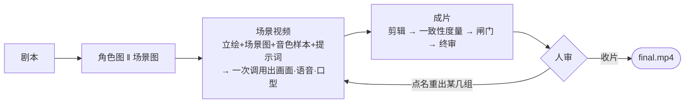

# FastVideo3 🎬

输入一个主题，产出一部带对白、带口型、带转场的 AI 短剧 —— **全程走 API，不需要 GPU**。

- **五步一条路径**：`剧本 → 角色图 → 场景图 → 场景视频 → 成片`。点一次补一步，每步之间人都能介入。
- **多模态**：一次 wan3.0 调用吃「角色立绘 + 场景图 + 音色样本 + 多镜头提示词」，直接吐出带口型的整段戏。
- **分辨率是唯一旋钮**（480P / 720P / 1080P）：尺寸、度量深度、单价量级、是否自动重拍都由它带出来。
- **一把 `DASHSCOPE_API_KEY` 跑通全系统**；花费到上限就停下问人，不静默少出片。

## 多模态 Agent 编排

同一个 run 两种走法、**一份执行器**：分步（面板 / `fastvideo3 step`）或图（`fastvideo3 graph`）。
缺口由 `core/progress.py` 从盘上算，执行只走 `core/stages.py` 这一份装配。



| 步骤        | 产出                                   | 模型                                 | 人能做什么                                              |
| ----------- | -------------------------------------- | ------------------------------------ | ------------------------------------------------------- |
| ① 剧本     | `script.json`                        | `qwen3.7-flash`                    | 编辑剧本稿（任意排版都能存）· 按意见重写 · 删除重生成 |
| ② 角色图   | `assets/char_*.png`                  | `wan2.7-image`                     | 生成 / 恢复 / 上传 / 改外貌描述（立绘是全片身份锚点）   |
| ③ 场景图   | `assets/scene_*.png`                 | `wan2.7-image`                     | 同上；长场景拆出的多段共用同一张场景图                  |
| ④ 场景视频 | `clips/scene_*.mp4` + 同名 `.json` | `wan3.0-video` · `cosyvoice-v2` | 改提示词、增删参考图、改时长、只重出某一组              |
| ⑤ 成片     | `final/final.mp4` + 字幕 + 度量报告  | FFmpeg + `qwen-vl-plus`            | 看片、点名重出、改字幕后只重跑剪辑                      |

## 快速开始：三条命令打开面板

先装两样免费软件：[Miniconda](https://docs.conda.io/en/latest/miniconda.html) 和
[Node.js](https://nodejs.org/zh-cn)（没有 node 就只有后台、打不开界面）。

```bash
./scripts/setup.sh          # 装环境。Windows 上换成 .\scripts\setup.ps1
conda activate fastvideo3   # 每次新开终端都要先这句
fastvideo3 serve            # 然后浏览器打开 http://127.0.0.1:8000
```

`setup.sh` 一条命令跑完六个阶段：建 conda 环境 → 装 Python 依赖 →（可选）装本地视觉组件 →
装本项目 → 生成 `.env` → 收 ffmpeg 与模型权重 + 构建前端 + 自检。**跑完就直接 serve，
不用再手工 `pip install` 任何东西。**
没装 conda 也不想装：加 `--venv`，改用项目内的 `.venv`。

## 照着点，出一条片

1. **顶栏「环境自检」**：12 项都绿就往下走；缺 ffmpeg 或权重就点「📦 补齐项目内置运行时」。
2. **「新建任务」→ 展开「模型选择」**：第一行粘贴百炼 API KEY（去 `bailian.console.aliyun.com` 申请），
   鼠标点到别处就自动存好。想确认这把 KEY 真能用，按「🔑 探活」——花一分钱左右，欠费或模型没开通当场就知道。
3. **填四个格子**：主题、时长（秒）、分辨率档位、成本上限（元）。
4. **第一次务必勾上 Fake**：不花钱、不需要 KEY，片子是占位色块，但五个步骤、每个按钮、`output/` 里的
   产物目录和真跑完全一样。摸清流程了再取消勾。
5. 点「▶ 开始生成」进详情页，**连着点五次**，一次补一步：剧本 → 角色图 → 场景图 → 场景视频 → 成片。
   跑的时候页面自己更新。真跑一条 30 秒的片大约 ¥10–90，取决于档位。
6. **每步之间都能改**：剧本稿直接在页面上编辑、角色图不满意就传自己的、某一组视频单独重出。
   改完只重算被影响到的那几个镜头，已经出来的不重做、不重复花钱。
7. **钱花到上限会自动停下来问你**，填个高一点的上限就接着跑，不是从头再来。
8. 第五步跑完就能看片、下载 `final.mp4`（文件在 `output/<你的run>/final/`）。

一次只允许跑一个生成任务，别的任务会提示"正在生成中"等它跑完。接口清单在 `fastvideo3/app/api.py` 开头。

## 命令行（与面板同一份执行器）

不想开浏览器时用这些命令，和面板走的是同一条流水线，**两边可以交替**（面板建的任务命令行接着补，反过来也行）。

```bash
fastvideo3 new --topic "校园喜剧" --duration 30 --fake    # Fake：零成本、无需 KEY
fastvideo3 step <run_id>                                 # 点一次补一步，共 5 次

fastvideo3 doctor --probe                                # 真跑前先探活（欠费/未开通别等烧钱才知道）
fastvideo3 new --topic "职场新人的第一天" --resolution 720P --budget 150
fastvideo3 step <run_id>                                 # 到上限会停下问人：
fastvideo3 budget-continue <run_id> 200                  #   抬上限，从停下处接着跑
```

常用命令：

| 想做的事                             | 命令                                                                                     |
| ------------------------------------ | ---------------------------------------------------------------------------------------- |
| 按意见改剧本（只作废真被改到的镜头） | `fastvideo3 script-regen <run> --prompt "…" --mode revise`                            |
| 只重出一张图 / 一组视频              | `fastvideo3 asset-gen` · `fastvideo3 scene-gen`                                     |
| 进度 / 成本 / 降级 / 一致性          | `fastvideo3 cost <run>` · `consistency <run>` · `output/<run>/run_summary.json`  |
| 只重跑剪辑（零 API 费）/ 消融四臂    | `python scripts/recompose_final.py <run>` · `python scripts/run_ablation.py --fake` |

## 项目结构

```
fastvideo3/
├── core/       # 判据：config(档位) progress(缺口) stages(唯一装配) storage(产物+血缘+事件)
│               #   scenegroup/voiceref/voice_budget draft_norm+script_text cost/pricing/pause tasklock
├── modules/    # 执行：m1 剧本 → m9 度量（与教学章节 1:1；m4_scene 是当前主干）
├── providers/  # 供应商：base(能力位/协议) factory(装配) 各家 API + fake(离线冒烟)
├── graph/      # 编排：builder(节点与回边) nodes(只调执行器) state checkpointer
├── app/        # 入口：cli.py(Typer) · api.py(FastAPI) · streamlit_app.py(教学观测)
└── utils/      # ffmpeg · audio · image · faceid(SFace) · lipsync · matting · emotion
web/            # Vue 3：NewRunForm · RunList · RunDetail(+ProductionBoard+StepBar) · DoctorView
configs/        # default.yaml(=480P 本体) + profile_720P/1080P.yaml + ablations/
prompts/ scripts/
tests/          # 700+ 条离线用例（Fake 供应商，无需 KEY）
output/<run_id>/# script.json assets/ storyboard/ audio/ clips/ final/ qc/
                # cost.json events.jsonl lineage.json degradations.json run_summary.json
```

## 技术栈

| 层          | 选型                                                                                                                                                                                                        |
| ----------- | ----------------------------------------------------------------------------------------------------------------------------------------------------------------------------------------------------------- |
| 语言 / 数据 | Python ≥ 3.11 · `asyncio` 全程异步 · Pydantic v2（剧本/资产/成本的唯一校验）                                                                                                                           |
| 编排        | LangGraph `StateGraph` + `interrupt()`；检查点 SQLite，或 PostgreSQL（`[postgres]` + Docker）                                                                                                         |
| 入口        | FastAPI + Uvicorn（`[web]`）· Typer + Rich · Vue 3 + Vite（产物由后端同源托管）                                                                                                                         |
| 生成模型    | `qwen3.7-flash` 文本 · `wan2.7-image` 文生图（带参考图 → 三档都靠它锁脸）· `wan3.0-video` 场景级生成（画面+语音+口型）· `cosyvoice-v2` 配音（降级免费 edge-tts 并留痕）· `qwen-vl-plus` 评审 |
| 本地        | FFmpeg（项目内 `bin/` 优先于系统 PATH）· Pillow · OpenCV/SFace 人脸度量                                                                                                                                 |
| 台账        | SQLite JobStore + JSON 文件：`cost.json` 逐条计费 · `events.jsonl` 全事件 · `lineage.json` 血缘 · `degradations.json` 降级                                                                       |
| HTTP        | httpx + tenacity 直连（不套 LLM 框架：请求形状、错误文本、计费口径都能直接读）                                                                                                                              |

**档位差异**（`GET /api/resolutions` 就是这张表；单价来自 `pricing.yaml`，`fastvideo3 refresh-prices` 回写）：

| 档位           | 成片尺寸   | 30 秒预估  | 锁脸 | 度量 | 自动重拍     | 立绘抽卡  |
| -------------- | ---------- | ---------- | ---- | ---- | ------------ | --------- |
| 480P 教学/试跑 | 540×960   | ≈¥10–16 | ✔   | 抽样 | ✘（只报告） | ✘        |
| 720P 交付      | 720×1280  | ≈¥23–35 | ✔   | 抽样 | ✔ ≤2 轮    | ✘        |
| 1080P 商业级   | 1080×1920 | ≈¥58–88 | ✔   | 全检 | ✔ ≤2 轮    | ✔ 2 候选 |

场景片段按输出秒计价 ¥0.3 / ¥0.6 / ¥1.2 —— **锁脸三档都开，重拍是唯一按档花钱的差别。**

## 开发者

```bash
pip install -e ".[dev]" && ruff check . && mypy fastvideo3
pytest          # 离线：单元 + Fake 全链路 + Web API（无需 KEY）
pytest -m api   # 真实 API 冒烟（需 .env）
cd web && npm ci && npm run build          # 产物 web/dist 由后端同源托管；index.html 带 no-cache，
                                           # 构建完普通刷新就是新版

fastvideo3 serve --reload                  # 改后端代码自动重启
cd web && npm run dev                      # 改前端要热更新：→ :5173，/api 自动代理到 :8000
fastvideo3 serve --host 0.0.0.0 --port 8710  # 局域网里另一台机器打开面板
python -m uvicorn fastvideo3.app.api:app --port 8000  # 不想装 fastvideo3 命令时，仓库根直接起
```

三条硬规矩（都有测试钉着）：**同一事实只有一份实现** · **降级必须响亮**（进 `degradations.json`
并出现在看板上，只写日志等于没写）· **不覆盖人工上传的资产**（`uploads.json` 是硬边界）。

每条质量说法都能对着一条 run 核：`keyframe_gen{ref_count,ref_ids}`（首帧带没带那张角色图）·
`clips/scene_*.json` 的 `ref_images`/`dropped`（真发了什么、丢了谁）· `cost.json`（钱打在哪个模型上）·
`consistency_report.json` + `degradations.json`（度量与降级）。
