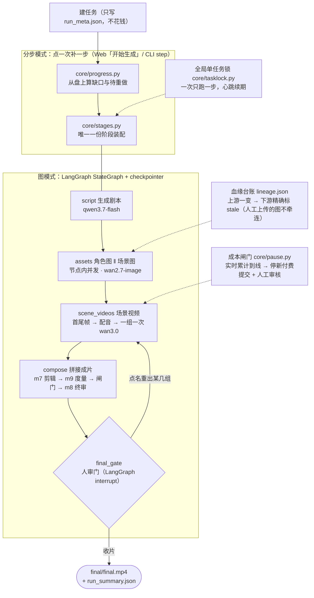
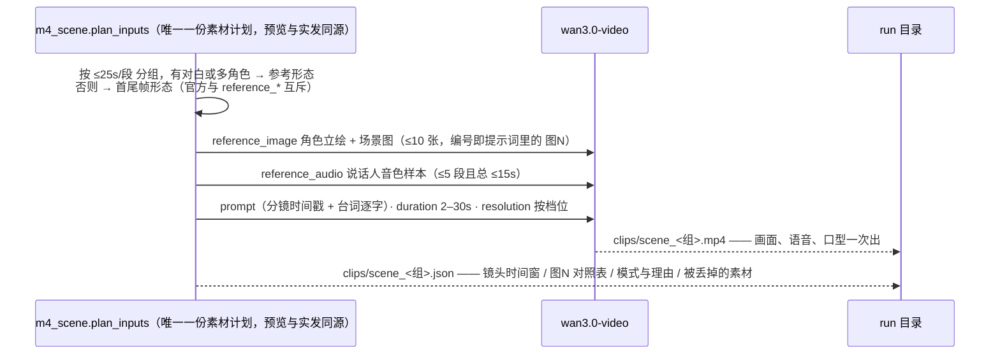

# FastVideo3 🎬

**输入一个主题，产出一部带对白、带口型、带转场的竖屏短剧 —— 全程走 API，不需要 GPU。**

- 生成推理全部走云 API（**一把 `DASHSCOPE_API_KEY` 跑通全系统**）；本地只留 CPU 级组件（FFmpeg / Pillow / SFace 人脸度量 / 可选 YOLO+rembg）。
- 生成只有**一条路径、五个步骤**：`剧本 → 角色图 → 场景图 → 场景视频 → 成片`。点一次补一步，**步骤之间人都能介入**（改剧本稿、换定妆照、删图重出、只重跑一组）。
- **多模态**：一次 wan3.0 调用同时吃「角色立绘 + 场景图 + 音色样本 + 多镜头提示词」，直接吐出**带口型的整段戏**（画面、语音、嘴型同源，组内多镜头天然连贯）。
- **分辨率是唯一的规格旋钮**（480P / 720P / 1080P）：成片尺寸、一致性深度、抽卡数、单价量级、是否自动重拍全部由它带出来 —— 只有一个旋钮，就不可能配出自相矛盾的组合。
- **钱到上限就停下来问人**（不是静默少出片）；已生成的产物永不重复付费 —— 产物、血缘、成本全在盘上，中断不需要"恢复"功能。

需求与设计：[PRD.md](PRD.md) · [TDD.md](TDD.md) · 实现细节与踩坑复盘：[INTEGRATION.md](INTEGRATION.md)

---

## 快速开始

```bash
# 1) 装环境（默认建项目内 .venv，不依赖 conda；Windows 用 .\scripts\setup.ps1）
./scripts/setup.sh
#    它按顺序做：.venv → 按 requirements.lock.txt 装依赖 → pip install -e .
#                → provision（ffmpeg 收进 bin/、身份权重进 models/、缺 .env 时从模板复制）
#                → cd web && npm ci && npm run build → doctor

# 2) 先零成本跑通（Fake 模式：占位产物、不花一分钱、无需任何 KEY）
fastvideo3 new --topic "校园喜剧" --duration 30 --fake      # 只写 run_meta.json，不花钱
fastvideo3 step <run_id>                                    # 点一次补一步，共 5 次

# 3) 真跑出片（先探活，欠费/未开通在烧钱之前暴露）
fastvideo3 doctor --probe
fastvideo3 new --topic "职场新人的第一天" --duration 30 --resolution 720P --budget 150
fastvideo3 step <run_id>                                    # ×5；到成本上限会停下问人
fastvideo3 budget-continue <run_id> 200                      # 抬高上限，从停下处接着跑

# 4) 或者直接开 Web 面板（推荐：每步之间能改剧本、换定妆照、删图重出）
pip install -e ".[web]"     # FastAPI + Uvicorn 是可选依赖，setup.sh 不装它们
fastvideo3 serve            # http://127.0.0.1:8000（--port 换端口，--host 0.0.0.0 对外）
```

前端开发模式（热更新）：起后端后在 `web/` 里 `npm run dev`，访问 http://127.0.0.1:5173（`/api` 自动代理）。

| 想做的事 | 命令 |
| --- | --- |
| 建任务 / 补一步 | `fastvideo3 new …` / `fastvideo3 step <run>`（面板里就是那颗「▶ 开始生成」） |
| 按人的意见改剧本 | `fastvideo3 script-regen <run> --prompt "…" --mode revise\|rewrite`（`revise` 只作废真被改到的镜头） |
| 只重出一张图 / 一组视频 | 面板单卡「生成 / 恢复」，或 `fastvideo3 asset-gen` / `fastvideo3 scene-gen` |
| 看进度、成本、降级 | `fastvideo3 cost <run>` · `fastvideo3 ls-runs` · `output/<run>/run_summary.json` |
| 一致性报告 / 消融四臂 | `fastvideo3 consistency <run>` · `fastvideo3 compare-consistency A B` · `python scripts/run_ablation.py --fake` |
| 只重跑剪辑（零 API 费用） | `python scripts/recompose_final.py <run>`（改字幕样式/音轨不用重买视频） |
| 全链路冒烟 | `python scripts/smoke_web_api.py`（Fake 模式：建任务 → 循环「开始生成」直到没有下一步 → 校验产物与越权防护） |

---

## 多模态 Agent 编排

同一个 run 有**两种编排、一份执行器**：分步模式（Web 面板 / `fastvideo3 step`，人逐步确认）与图模式（`fastvideo3 graph`，一次跑到人审门停下）。两者调的都是 `core/progress.py`（从盘上算缺口）+ `core/stages.py`（唯一装配入口）+ `cli._run_step`。



**图只管四件事：顺序、并行、中断、恢复。** 每一步做什么、花不花钱、要不要重做，全部落在执行器那一份判据里 —— 图上绝不重复实现业务（同一逻辑存在两份实现，是本项目历史上所有静默质量退化的共同根源）。自动重做 ≤2 轮只在 `compose` 里，**图上的回边只承载"人"的决定**。

| 步骤 | 产出 | 主要模型 | 人在这一步能做的事 |
| --- | --- | --- | --- |
| ① script | `script.json`（角色/场景/镜头/台词的结构化剧本） | `qwen3.7-flash` | ✎ 编辑剧本稿（**任意排版都能存**：本地确定性整理，整理不动才调一次 TEXT 只改排版并逐字校验台词没被改）· 🎲 按意见重写 · 🗑 删除重生成 |
| ② chars | `assets/char_{角色}.png` | `wan2.7-image`（立绘是**全片身份锚点**） | 单卡「生成 / 恢复」· ⬆ 上传替换 · 改外貌描述 |
| ③ scenes | `assets/scene_{场景}.png`（空景，无人物） | `wan2.7-image` | 同上；超 25s 拆出的多段**共用同一张场景图** |
| ④ scene_videos | `clips/scene_{组}.mp4` + 同名 `.json` | `wan3.0-video`（一次调用出画面+语音+口型）· `cosyvoice-v2` 出音色样本 | 逐组编辑图生视频提示词 · 增删参考图 · 改时长 · 只重出某一组 |
| ⑤ compose | `final/final.mp4` + 字幕 + `consistency_report.json` + `qc/` | 本地 FFmpeg + `qwen-vl-plus` 度量/终审 | 看片、点名重出、改字幕样式后只重跑剪辑 |

每一步都留了**盘上证据**（不用信文档，直接对着一条 run 核）：

- `events.jsonl` 的 `keyframe_gen{ref_count,ref_ids,seed,seed_scope}` —— 首帧到底带没带那张角色图；
- `clips/scene_<组>.json` 的 `mode` / `ref_images` / `dropped` —— 这次真发了哪些参考素材、丢了谁；
- `cost.json` 逐条 `{capability, provider, model, cost_cny}` —— 钱实际打在哪个模型上；
- `consistency_report.json` + `degradations.json` —— 度量结果与"这次哪件事没做成"。

第 ④ 步里那次"多模态"调用长这样（素材预算是官方硬约束，超了服务端直接 400）：



**中断与恢复不需要特殊代码**：产物在盘且未被血缘标 stale 就跳过；异步视频任务另有任务台账，**在途任务接着轮询而不是重新提交**（重新提交就是为同一秒画面付第二次钱）。成本到线时 `core/pause.py` 写 `pause.json`、停止新的付费提交并等人工确认（在途任务照常收回来）——「确认继续」即抬高上限并从停下处接着跑。

```bash
fastvideo3 graph <run_id>                          # 跑到人审门停下（成片已产出）
fastvideo3 graph <run_id> --resume --redo scene_2  # 不满意：只重出这一组，再交人审
fastvideo3 graph <run_id> --resume --finish        # 收片
docker compose up -d                               # 进阶：把台账/检查点切到 PostgreSQL
```

---

## 项目结构

```
fastvideo3/
├── core/        # 判据层：config(档位/分辨率) · progress(缺口状态机) · stages(唯一装配) ·
│                #   storage(产物+血缘+事件) · scenegroup(分组与素材预算) · voiceref(音色样本) ·
│                #   voice_budget(软校验) · draft_norm/script_text(任意排版→标准剧本稿) ·
│                #   cost/pricing/billing/pricetable · pause(成本闸门) · tasklock · talkmode ·
│                #   model_catalog(面板可选模型的唯一清单) · envfile(.env 定点写回)
├── modules/     # 执行层，m1 剧本 → m9 度量（与教学章节 1:1 映射；m4_scene 是当前主干）
├── providers/   # 供应商层：base(能力位/协议) + factory(装配) + dashscope/deepseek/
│                #   siliconflow/kling/fal/edge_tts + fake(Fake 全家桶，离线冒烟) + protocols
├── graph/       # LangGraph 编排：builder(节点与条件回边) · nodes(只调执行器) · state · checkpointer
├── app/         # cli.py(Typer) · api.py(FastAPI，42 个路由) · streamlit_app.py(教学观测)
└── utils/       # ffmpeg · audio · image · faceid(SFace 人脸 embedding) · lipsync · matting · emotion
web/             # Vue 3 + Vite 面板：NewRunForm / RunList / RunDetail(+ProductionBoard+StepBar) / DoctorView
configs/         # default.yaml(=480P 本体) + profile_720P.yaml + profile_1080P.yaml + ablations/
prompts/         # 提示词模板（渲染器在 core/prompts.py）
scripts/         # setup.sh|ps1 · probe_*(探活/零成本体检) · run_ablation.py · recompose_final.py · smoke_web_api.py
tests/           # 739 条：单元 + Fake 全链路冒烟 + Web API；真实 API 冒烟打 -m api 标记
output/<run_id>/ # 一条 run 的全部产物：script.json · assets/ · storyboard/ · audio/ · clips/ ·
                 # talk/ · final/ · qc/ · review/ · cost.json · events.jsonl · lineage.json ·
                 # degradations.json · consistency_report.json · pause.json · run_meta.json · run_summary.json
```

---

## 技术栈

| 层 | 选型 | 说明 |
| --- | --- | --- |
| 语言 / 运行 | **Python ≥ 3.11**，`asyncio` 全程异步 | 供应商调用与模块内并发（m4/m5 各自信号量）都是异步的 |
| 数据模型 | **Pydantic v2** | 剧本/资产/成本/事件的 schema 与校验唯一来源（`core/schema.py`） |
| 编排 | **LangGraph** `StateGraph` + `interrupt()` | 检查点：`AsyncSqliteSaver`（每 run 一个 `graph.sqlite`，零配置）或 `AsyncPostgresSaver`（`[postgres]` + Docker） |
| API 服务 | **FastAPI + Uvicorn**（`[web]` 可选依赖） | 42 个 REST 路由，Swagger 在 `/docs`；产物由 `GET /api/files/...` 流式回传 |
| 前端 | **Vue 3.5 + Vite 6**（无路由库：四个视图靠组件状态切换） | 构建产物 `web/dist/` 由 FastAPI **同源托管**（`index.html` 走 `no-cache`，`/assets/*` 内容寻址长缓存） |
| 命令行 | **Typer + Rich** | 面板能做的全都能不进浏览器做；两者落到同一份执行器 |
| 文本 / 编剧 | **qwen3.7-flash**（可切 plus / max / 3.8 系，DeepSeek 兜底） | 剧本生成 + 提示词蒸馏校验 + 排版规范化兜底 |
| 文生图 | **wan2.7-image**（qwen-image 系可选，面板可切） | multimodal-generation 同步端点，**支持参考图** → 三档都靠它锁脸 |
| 图生视频 / 口型 | **wan3.0-video 场景级生成** | 一次调用出画面+台词语音+口型；`reference_image` ≤10、`reference_audio` ≤5 段且总 ≤15s、时长 2–30s，且与 `first_frame/last_frame` **互斥** |
| 配音 | **cosyvoice-v2**（失败降级免费 edge-tts 并留痕） | 音色按性别分桶确定性分配；母带同时是场景片段的**音色参考**原料 |
| 度量 / 评审 | **qwen-vl-plus** VLM 属性位 + **SFace**（`opencv`，缺权重/缺能力时自动退回 A/B 层并如实标注）人脸 embedding 余弦 + 纯 PIL 色相 | 三层交叉：VLM 给可行动原因、SFace 给客观证据、色相只做证伪 |
| 后期 | **FFmpeg**（`imageio-ffmpeg`）+ Pillow | 规格统一 / xfade 转场 / 字幕烧录 / BGM / 调色 / 响度；项目内置 `bin/` 优先于系统 PATH |
| 存储 / 台账 | SQLite（JobStore，可切 PostgreSQL）+ 纯文件 JSON | `cost.json` 逐条计费、`events.jsonl` 全事件、`lineage.json` 血缘、`degradations.json` 降级 |
| 供应商 SDK | 全部直接 **httpx**（+ `tenacity` 重试），SDK 只有两处：`dashscope` 的 cosyvoice 语音合成与本地文件上传 | 不套 LangChain 的 LLM 封装：更薄，请求形状 / 错误文本 / 计费口径都能直接读 |
| 质量门禁 | `ruff` · `mypy` · `pytest`（739 条，Fake 全链路离线可跑）；CI 四个步骤：lint / 类型 / 测试 / 前端构建 | 真实 API 冒烟打 `pytest -m api`，需 `.env` |

**分辨率档位与成本**（`GET /api/resolutions` 就是这张表，单价来源 `pricing.yaml`，`fastvideo3 refresh-prices` 从官网价目页回写）：

| 档位 | 成片尺寸 | 30 秒预估 | 参考图锁脸 | 一致性度量 | 不达标自动重拍 | 立绘抽卡 |
| --- | --- | --- | --- | --- | --- | --- |
| **480P**（教学/试跑） | 540×960 | ≈ ¥10–16 | ✔ 全档开 | 抽样 | ✘（重拍要花钱，只报告） | ✘ |
| **720P**（交付） | 720×1280 | ≈ ¥23–35 | ✔ | 抽样 | ✔ ≤2 轮 | ✘ |
| **1080P**（商业级） | 1080×1920 | ≈ ¥58–88 | ✔ | 全检 | ✔ ≤2 轮 | ✔ 2 候选（镜头级抽卡只服务历史逐镜头路径） |

场景片段按**输出秒**计价：wan3.0-video 480P ¥0.3/秒 · 720P ¥0.6/秒 · 1080P ¥1.2/秒。零成本演示与四臂消融请用 `--fake`。

---

## 开发者

```bash
pip install -e ".[dev]"
ruff check . && mypy fastvideo3
pytest                          # 离线：单元 + Fake 全链路 + Web API（无需 KEY）
pytest -m api                   # 真实 API 冒烟（需 .env，nightly 跑）
cd web && npm ci && npm run build
```

三条写代码时必须守住的规矩（都被测试钉着）：

1. **一份判据**。同一事实出现两份实现，就会漂一次、静默退化一次 —— 本项目历史上几乎所有"看起来通电、实际无效"的质量故障都是这个形状（面板显示 A 模型实际打 B、锁脸开关开着但路由收不了参考图、熔断到线静默跳过剩余提交）。
2. **降级必须响亮**。任何"少做了一件事"都要进 `events.jsonl` + `degradations.json` 并出现在看板上，只写日志等于没写。
3. **不覆盖人工上传的东西**。`uploads.json` 是硬边界：血缘作废跳过它，重生成也跳过它 —— 用户花钱换的图不能被流水线悄悄换回去。
