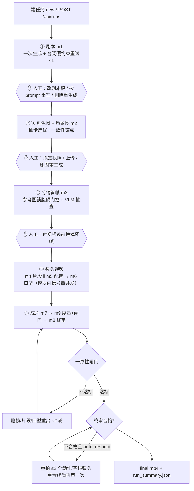

# FastVideo3 技术设计文档（TDD）

| 项 | 内容 |
|---|---|
| 文档版本 | v1.0 |
| 日期 | 2026-08-22 |
| 对应需求 | `PRD.md` v1.0 |
| 状态 | 待评审 |
| 构建流程 | PRD ✅ → **TDD（本文档）** → 生成各模块 → CI 自检 → 系统联调 |

---

## 1. 概述与设计原则

### 1.1 技术目标

实现 PRD 的两大约束：**① 所有生成类推理全部 API KEY 化（零 GPU）；② 流水线可教学、可演进 —— 一条执行路径、一份阶段装配、每一步之间人可介入。**

### 1.2 设计原则

| 原则 | 落地方式 |
|---|---|
| **API-first** | 一切生成能力（文本/图像/视频/口型/语音/视觉评审）均通过 Provider 抽象调用云端 API；本地只保留 CPU 级能力（YOLOv8-seg、rembg、FFmpeg） |
| **Schema-first** | Pydantic v2 定义全链路数据契约（剧本→资产→分镜→镜头→成片），LLM 输出强制 JSON Schema 校验 |
| **Provider 模式** | 每类能力一个抽象接口，供应商是可插拔实现；新增供应商零业务代码改动 |
| **盘上即状态** | 生产流程 = 六步顺序；"下一步做什么"由 `core/progress.py` 从盘上产物 + 血缘台账算出来，不依赖内存/图状态 |
| **一份装配** | 所有阶段装配只在 `core/stages.py` 一处（参考图锁脸、抽卡、风格闸门、r2v、降级台账）；同一逻辑出现两份实现就是静默退化的温床 |
| **可离线教学** | Fake Provider 用本地占位素材替代全部 API，零成本跑通全链路（教学与单测默认模式） |
| **失败可恢复** | 所有外部调用幂等化 + 产物与血缘落盘 + 任务台账，任何位置中断后再点一次只补缺口 |

### 1.3 总体技术选型结论

| 关注点 | 选型 | 理由 |
|---|---|---|
| 流程编排 | **自研顺序状态机**（`core/progress.py` + `core/stages.py`） | 六步依赖关系是线性的，盘上产物就是状态：不需要图引擎，也就不用为"检查点/中断恢复"维护第二套真相（2026-10-06 删除 LangGraph 端到端路径，见 §5） |
| LLM 接入层 | LangChain + OpenAI 兼容 SDK | DeepSeek/百炼均兼容 OpenAI 协议，一套代码双供应商 |
| 数据契约 | Pydantic v2 + pydantic-settings | 类型安全 + 配置管理一体 |
| 异步 | asyncio + httpx | 视频/图像 API 均为异步任务，天然适配 |
| 数据库 | 默认 SQLite（零配置）；进阶 PostgreSQL 16（Docker Compose 一键） | 教学零门槛 / 生产可并发，两档配置 |
| 本地 CPU 组件 | ultralytics（YOLOv8n-seg）+ rembg + FFmpeg | 继承 FastVideo2 的双人同屏能力 |
| 界面 | Typer CLI + Streamlit Web | CLI 服务教学脚本化，Web 服务可视化 |
| 质量 | pytest + ruff + mypy + GitHub Actions | 每模块独立 CI 自检 |

---

## 2. 系统架构

### 2.1 分层架构

```
┌────────────────────────────────────────────────────────────────┐
│ 接入层    Vue Web 面板(FastAPI)  │  Typer CLI  │  Streamlit(教学观测)  │
├────────────────────────────────────────────────────────────────┤
│ 编排层    core/progress.py 六步状态机（下一步该做什么）           │
│           core/stages.py 阶段执行器（唯一装配入口）                │
│           人工闸门：每一步之间（改剧本稿 / 换图 / 删图重生成）      │
├────────────────────────────────────────────────────────────────┤
│ 模块层    m1 剧本 │ m2 资产 │ m3 分镜 │ m4 镜头 │ m5 配音        │
│           m6 口型/双人同屏 │ m7 剪辑合成 │ m8 评审                │
├────────────────────────────────────────────────────────────────┤
│ Provider 层  Text│T2I│I2V│Talk│TTS│VLM  统一异步契约+重试+计费    │
│   实现: DeepSeek / 百炼DashScope / SiliconFlow / 可灵 / edge-tts │
│   Fake: 本地占位素材（离线教学/测试）                              │
├────────────────────────────────────────────────────────────────┤
│ 本地 CPU 组件  YOLOv8n-seg（人物分割） │ rembg（抠图）            │
│               FFmpeg（转场/拼接/混音/字幕） │ librosa（音频）      │
├────────────────────────────────────────────────────────────────┤
│ 基础设施    SQLite/PostgreSQL │ 文件系统 output/<run_id>/ │ .env  │
└────────────────────────────────────────────────────────────────┘
```

### 2.2 一次完整生成的数据流

```
topic ─→ Script(JSON) ─→ AssetRegistry(角色/场景图)
      ─→ Storyboard(每镜头首帧) ─┬→ I2V jobs(动作/风景镜头) → clips/*.mp4
                                 └→ TTS → wavs ─→ S2V jobs(对话镜头: 首帧+音频直出) → talk/*.mp4
      ─→ Editor(规格统一 → xfade 转场 → 字幕 → BGM 混音) ─→ final.mp4
      ─→ Reviewer(VLM 评审记录) + cost.json（成本台账）
```

---

## 3. 运行环境与部署（★ 环境配置专章）

> 对应需求：conda 虚拟环境 + requirements.txt；数据库走 Docker 镜像、docker compose 一键拉起。

### 3.1 环境总览

| 组件 | 要求 | 必需性 |
|---|---|---|
| 操作系统 | Windows 10/11、Linux、macOS | — |
| Miniconda/Anaconda | Python 3.11 环境 | **必需** |
| GPU | **不需要**（推理全 API 化；YOLO/rembg 走 CPU） | — |
| FFmpeg ≥ 6.0 | 转场/合成引擎 | **必需** |
| Docker + Docker Compose | 仅进阶数据库模式需要 | 可选 |
| API KEY | DeepSeek + 阿里云百炼（最小集，见 §10） | **必需**（Fake 模式除外） |

### 3.2 一键环境搭建流程（将固化为 `scripts/setup.sh` / `setup.ps1`）

```bash
# ── 步骤 1：创建 conda 虚拟环境（Python 3.11）─────────────
conda env create -f environment.yaml        # 或手动:
# conda create -n fastvideo3 python=3.11 -y
conda activate fastvideo3

# ── 步骤 2：安装 Python 依赖 ─────────────────────────────
# ⚠ 先装 CPU 版 PyTorch（仅 YOLO 本地推理用），否则会默认拉 2.5GB+ 的 CUDA 版:
pip install torch --index-url https://download.pytorch.org/whl/cpu
pip install -r requirements.txt
pip install -e .                            # 以可编辑模式安装本项目, 获得 fastvideo3 CLI

# ── 步骤 3：安装 FFmpeg ──────────────────────────────────
# Windows:  winget install --id Gyan.FFmpeg        (或 conda install -c conda-forge ffmpeg)
# Linux:    sudo apt install ffmpeg
# macOS:    brew install ffmpeg
ffmpeg -version                             # 自检: 需 >= 6.0

# ── 步骤 4：配置 API KEY ─────────────────────────────────
cp .env.example .env                        # 然后填入真实 KEY (见 §10)

# ── 步骤 5：本地小模型下载（CPU 组件）────────────────────
python -m fastvideo3.utils.fetch_models     # 下载 yolov8n-seg.pt (~6MB) 到 models/

# ── 步骤 6（可选·进阶）：数据库 ──────────────────────────
docker compose up -d                        # 一键拉起 PostgreSQL 16
fastvideo3 doctor                           # 环境自检: 依赖/ffmpeg/KEY/DB 全项体检
```

### 3.3 `environment.yaml`（conda 环境定义）

```yaml
name: fastvideo3
channels: [conda-forge, defaults]
dependencies:
  - python=3.11
  - pip
  - ffmpeg>=6.0          # conda-forge 渠道, 跨平台一致
  - pip:
      - -r requirements.txt
```

### 3.4 `requirements.txt` 依赖清单（锁定版本于 M1 开工时生成锁文件）

| 分组 | 依赖 | 用途 |
|---|---|---|
| LLM/SDK | `dashscope>=1.20`（百炼：文本/图像/视频/口型/语音/视觉）、`httpx` 直连其余兼容端点 | 全部生成能力 |
| 数据 | `pydantic>=2.7`、`pydantic-settings`、`python-dotenv`、`pyyaml` | 契约与配置 |
| 网络 | `httpx`、`tenacity` | 异步 HTTP 与重试 |
| 语音 | `edge-tts`（免费默认 TTS）、`librosa`、`soundfile` | 对白合成与音频处理 |
| 视觉本地 | `torch`（**仅 CPU 版**，经 cpu index 安装）、`ultralytics`（YOLOv8n-seg）、`rembg[cpu]`、`onnxruntime`、`opencv-python`、`pillow`、`numpy` | 双人分割/抠图/合成（无 GPU 依赖） |
| 视频 | `ffmpeg-python`（薄封装，复杂滤镜仍走原生命令） | 转场/拼接/混音/字幕 |
| 界面 | `fastapi`、`uvicorn`（Vue 面板后端）、`typer`、`rich`、可选 `streamlit` | Web 面板与 CLI |
| 数据库 | `SQLAlchemy>=2`、`aiosqlite`（默认）；可选组 `[postgres]`: `psycopg[binary]` | 异步任务台账（JobStore） |
| 开发 | `pytest`、`pytest-asyncio`、`pytest-cov`、`ruff`、`mypy`、`respx`（HTTP mock） | 测试与 CI |

> 编排框架已移除：`langgraph` / `langchain` 及其 checkpoint 包不再是依赖（2026-10-06，见 §5）。

### 3.5 数据库设计：两档模式

**为什么需要数据库**：① 异步生成任务台账（I2V/S2V 任务的 job_id、状态、产物路径）——"任务 SUCCEEDED 且产物在盘"双条件跳过就靠它，避免重复付费；② 成本流水与评审记录（同时以 JSON 落 run 目录，便于人读）。

**模式 A：`edu-sqlite`（教学默认，零配置）**
- SQLite 文件随项目目录走，无需任何安装；任务台账用 SQLAlchemy。

**模式 B：`prod-postgres`（进阶/多人并发，Docker 一键）**

`docker-compose.yml` 设计（M1 随脚手架交付）：

```yaml
services:
  postgres:
    image: postgres:16-alpine          # 官方镜像, 拉取即用
    container_name: fv3-postgres
    environment:
      POSTGRES_DB: ${FV3_PG_DB:-fastvideo3}
      POSTGRES_USER: ${FV3_PG_USER:-fv3}
      POSTGRES_PASSWORD: ${FV3_PG_PASSWORD:-fv3_change_me}
    ports: ["5432:5432"]
    volumes: [fv3_pgdata:/var/lib/postgresql/data]
    healthcheck:
      test: ["CMD-SHELL", "pg_isready -U ${FV3_PG_USER:-fv3}"]
      interval: 5s
      retries: 10
  pgadmin:                              # 可选: 数据库可视化(教学演示用)
    image: dpage/pgadmin4:latest
    profiles: ["tools"]                 # docker compose --profile tools up -d 才启动
    environment:
      PGADMIN_DEFAULT_EMAIL: admin@fastvideo3.local
      PGADMIN_DEFAULT_PASSWORD: ${FV3_PGADMIN_PASSWORD:-admin}
    ports: ["5050:80"]
    depends_on: [postgres]
volumes:
  fv3_pgdata:
```

- 一键命令：`docker compose up -d`（拉镜像 + 起服务 + 健康检查）；`docker compose down` 停止；数据卷持久化。
- 应用侧通过配置切换：`config.profile: edu-sqlite | prod-postgres`，JobStore 的 `db_url` 据此选择 SQLite 或 PostgreSQL，**业务代码零感知**。
- 无 Docker 的学生永远不需要碰这一节——这是教学设计，不是妥协。

### 3.6 环境自检 `fastvideo3 doctor`

逐项检查并输出表格：conda/Python 版本 → 依赖可导入 → `ffmpeg -version` → `.env` KEY 存在性（不打印明文）→ 各 API `health_check`（可选）→ 数据库连通 → `models/yolov8n-seg.pt` 就位。任一失败给出修复指引。

---

## 4. 数据模型设计（Pydantic v2）

### 4.1 核心实体关系

```
ProjectConfig 1─1 Script 1─N Scene 1─N Shot
Script 1─N Character 1─1 Asset(立绘)
Scene 1─1 Asset(场景概念图)
Shot 1─1 StoryboardFrame(首帧) 1─0..1 AudioClip(台词) 1─0..1 ShotClip(视频)
RunJob 记录每个异步 API 任务; ReviewResult 记录每次评审; CostEntry 记录每笔花费
```

### 4.2 关键模型定义（设计签名）

```python
class BaseInfo(BaseModel):
    topic: str
    style: str
    culture_background: str
    target_duration_sec: int = 180
    episode: int = 1
    aspect_ratio: Literal["9:16", "16:9", "1:1"] = "9:16"  # 竖屏短剧为默认形态


class ShotType(str, Enum):
    DIALOGUE = "dialogue"  # 对话镜头 → TTS + S2V 直出(默认模式)
    ACTION = "action"  # 动作镜头 → 仅 I2V
    SCENERY = "scenery"  # 风景转场镜头 → I2V, 作转场素材


class TransitionType(str, Enum):
    CUT = "cut"
    DISSOLVE = "dissolve"
    FADE = "fade"
    SCENERY = "scenery"


class DialogueLine(BaseModel):
    character_id: str
    text: str
    emotion: str = "neutral"


class Shot(BaseModel):
    shot_id: str
    scene_id: str
    type: ShotType
    duration_sec: float = 5.0  # 镜头时长(I2V/S2V 定长输出)
    characters: list[str]  # character_id 列表
    action: str  # 动作/画面描述
    camera: str = ""  # 镜头语言(推/拉/摇/移/特写)
    dialogues: list[DialogueLine] = []
    transition_out: TransitionType = TransitionType.CUT
    visual_prompt: str = ""  # 供 T2I/I2V 的最终提示词


class Scene(BaseModel):
    scene_id: str
    title: str
    location: str
    time_of_day: str
    summary: str
    shots: list[Shot]


class Character(BaseModel):
    character_id: str
    name: str
    appearance: str  # 外貌固化描述
    voice_id: str = ""  # TTS 音色


class Script(BaseModel):
    base_info: BaseInfo
    characters: list[Character]
    scenes: list[Scene]
    version: int = 1


class ProjectConfig(BaseModel):
    """一次生成任务的全部运行配置（写入 run_meta.json，每一步都按它原样恢复）"""

    run_id: str
    base_info: BaseInfo
    profile: Literal["edu-sqlite", "prod-postgres"] = "edu-sqlite"
    talk_mode: Literal["s2v_direct", "v2v_overlay", "audio_overlay"] = "s2v_direct"
    budget_limit_cny: float = 150.0
    max_parallel_jobs: int = 4


class Asset(BaseModel):
    asset_id: str
    kind: Literal["character", "scene"]
    owner_id: str
    uri: str
    meta: dict = {}


class RunJob(BaseModel):
    job_id: str
    capability: str
    provider: str
    params: dict
    status: Literal["pending", "running", "succeeded", "failed"]
    output_uri: str | None
    error: str | None
    submitted_at: datetime
    finished_at: datetime | None


class ReviewResult(BaseModel):
    target: str
    passed: bool
    score: float
    feedback: str
    rubric: str


class CostEntry(BaseModel):
    ts: datetime
    capability: str
    provider: str
    model: str
    amount_cny: float
    note: str = ""
```

### 4.3 输出目录契约（`output/<run_id>/`）

```
output/<run_id>/
├── script.json            # 结构化剧本(含迭代版本)
├── assets/                # 角色立绘/场景概念图 + registry.json
├── storyboard/            # shot_<id>.png 首帧
├── audio/                 # line_<id>.wav 对白
├── clips/                 # shot_<id>.mp4 I2V 产物
├── talk/                  # shot_<id>_talk.mp4 口型产物
├── review/                # 评审记录 JSON + 截图
├── final/                 # final.mp4 + srt 字幕
├── cost.json              # 成本台账
└── run_meta.json          # 配置快照、进度、断点信息
```

---

## 5. 执行编排设计（顺序阶段 + 人工闸门）

> **2026-10-06 变更**：删除 LangGraph 端到端路径（`graph/builder.py`/`nodes.py`/`state.py`、
> `interrupt()` 审片门、`SqliteSaver` 检查点、`/continue`、`/resume`、CLI `run`/`resume`）。
> 理由：逐步路径已经具备图路径的全部产出能力（成片终审、一致性度量与 ≤2 轮自动重做、
> best-of-N 选优、风格闸门、降级台账），图只多出"两处人工中断门 + shots‖audio 图级并行 +
> 检查点续跑"；而人工中断门在分步模式下由"每步等人点一次"天然覆盖，续跑由盘上产物 +
> 血缘台账覆盖。**同一逻辑存在两份实现，是本项目历史上所有静默质量退化的共同根源**，
> 因此收敛为一条路径、一份装配。

### 5.1 阶段（原 Agent 角色）清单

| 阶段 | 执行器 | 职责 | 主要能力依赖 |
|---|---|---|---|
| **剧本** | `stage_script` (m1) | 主题→结构化剧本（**一次生成**）；按**人工**意见改写这份剧本（解析模式） | TEXT（JSON 输出） |
| **资产** | `stage_assets` (m2) | 角色立绘、场景概念图的提示词工程与生成（一致性锚点） | T2I + VLM（抽卡选优） |
| **分镜** | `stage_storyboard` (m3) | 每镜头首帧生成（参考图注入按**有效在场**：`characters` + 台词说话人 + 画面点名，漏标补进槽位并落 `cast_implied`）+ VLM 一致性抽查 | T2I + TEXT（提示词蒸馏）+ VLM |
| **镜头** | `stage_shots` (m4) | 动作/风景镜头的 I2V（或 r2v 参考生视频）提交与轮询、best-of-N 选优 | I2V / R2V + VLM |
| **配音** | `stage_audio` (m5) | 对白 TTS、音色管理、时长对齐 | TTS |
| **口型** | `stage_talk` (m6) | 对话镜头 S2V 直出（首帧+音频→说话视频）；失败降级叠音并留痕 | TALK + VLM（口型度量） |
| **剪辑** | `stage_edit` (m7) | 规格统一、xfade 转场、字幕、BGM、混音、成片 | FFmpeg |
| **度量** | `stage_metrics` (m9) | 人物一致性度量 + 闸门（不达标自动重做 ≤2 轮） | VLM |
| **终审** | `stage_review` (m8) | 成片终审：抽代表帧送 VLM，失败放行但留痕（分数不可伪造） | VLM |

> 剧本评审不在表内：它已**移交人工**（改剧本稿 / 按 prompt 重写 / 删除重生成）。

### 5.2 状态定义：run 目录就是状态

没有内存态/图状态需要持久化 —— 真相全在盘上，重启后重算即可：

```python
# core/progress.py：六步状态机的输出（前端只读展示，判定一律在后端）
STEP_ORDER = ["script", "chars", "scenes", "frames", "videos", "compose"]

@dataclass
class StepState:
    id: str                       # script | chars | scenes | frames | videos | compose
    label: str                    # 生成剧本 | 生成角色图 | …
    state: Literal["pending", "gap", "done", "active", "failed"]
    missing: list[str]            # 缺口（该有却没有的产物 id）
    stale: list[str]              # 待重做（血缘判据标记为过期的产物）
    error: str | None

@dataclass
class ProgressReport:
    steps: list[StepState]; next: StepState | None
    running: bool; spent_cny: float; budget_cny: float
```

盘上真相的三本台账：`script.json` 等产物文件、`lineage.json`（产物 ← 上游的血缘 + `stale` 标记）、
`run_meta.json`（配置快照）；另有 `cost.json`（成本）、`events.jsonl`（事件流）、
`degradations.json`（降级台账）、`run_summary.json`（判定与终审结论）。

### 5.3 流程（线性六步，每步之间是人工闸门）



### 5.4 关键机制

| 机制 | 实现 |
|---|---|
| 下一步该做什么 | `progress.compute_progress`：从盘上产物 + `is_stale` + 事件流算六步状态，取最靠前的 `gap`；纯函数、可单测 |
| 并行 | 只在**模块内**：m4/m5/m6 用 `asyncio.Semaphore` 并发提交多个异步任务；并发上限 `max_parallel_jobs`，且不得超过供应商账号的异步任务配额（百炼新账号视频并发常仅 2–5）。图级扇出（shots‖audio）已随端到端路径删除；逐镜头 map-reduce 编排留作进阶练习 |
| 中断恢复 | 不需要检查点：产物在盘、`JobStore` 记着每个异步任务的 SUCCEEDED 与产物路径，跳过条件是"任务成功 **且** 产物在盘"；再点一次「开始生成」只补缺口与 `stale`，已付费的不重跑 |
| 人工介入 | **每一步之间**都是闸门（点一次走一步）；剧本另给三个动作：改剧本稿（本地确定性解析）/ 按 prompt 重写（`revise` 保留剧情、`rewrite` 推倒重写）/ 删除重生成。`interrupt()` 审片门与 `review_mode` 配置位已删除 |
| 评审分工 | 剧本 = 人工（Web 面板）；分镜/镜头/成片 = 自动评审（VLM 抽查、best-of-N 选优、成片终审）+ m9 一致性闸门 |
| 评审循环 | 一致性闸门 ≤2 轮自动重做（`gate_failures` 点名镜头）；终审不合格时 `auto_reshoot`（默认关）重拍一轮再审一次；预算耗尽 → 降级放行并落台账（流程不卡死） |
| 成本熔断 | 每笔 `CostEntry` 后检查 `budget_limit_cny`，超限抛错终止本步（已产出的产物保留，续点不重复花钱） |
| 可观测 | 每步进出写 `events.jsonl`（时间/花费/输入输出摘要/降级），看板与 CLI 同源读取 |
| 单任务锁 | `core/tasklock.py`：全局一次只允许一个生成任务（文件锁 + 心跳 + TTL），所有 spawn 子进程的端点先持锁 |

---

## 6. 模块详细设计

> 每个模块：单一职责、独立可运行（`fastvideo3 stage <name>`）、接口先行、Fake 可替换。接口签名为设计稿，实现阶段细化。

### 6.0 基础层 `core/`

| 模块 | 职责 | 关键接口 |
|---|---|---|
| `core.config` | 配置加载：`.env` + `configs/*.yaml`，provider 路由 | `get_settings() -> Settings` |
| `core.schema` | §4 全部 Pydantic 模型 | — |
| `core.storage` | run 目录管理、产物路径契约 | `RunStorage(run_id).path(stage, name)` |
| `core.cost` | 成本台账：记账、汇总、熔断检查 | `ledger.record(entry)`、`ledger.exceeded()` |
| `core.jobs` | 异步任务台账（RunJob 持久化与查询） | `jobs.submit/get/update` |

### 6.1 Provider 层 `providers/`

```python
class Provider(ABC):
    capability: Capability        # TEXT/T2I/I2V/TALK/TTS/VLM
    name: str; model: str
    async def health_check(self) -> bool

class TextProvider(Provider):     # 剧本/提示词/评审意见
    async def chat(self, messages, *, json_schema: type[BaseModel] | None) -> str
class T2IProvider(Provider):      # 立绘/场景/首帧
    async def generate(self, prompt, *, size, ref_image: Path | None) -> ImageResult
class I2VProvider(Provider):      # 异步任务模式
    async def submit(self, image: Path, prompt: str, **kw) -> str        # job_id
    async def poll(self, job_id: str) -> JobStatus                       # 含产物下载
class TalkProvider(Provider):     # 音频驱动说话视频 (S2V)
    async def submit(self, visual: Path, audio: Path) -> str
    async def poll(self, job_id: str) -> JobStatus
class TTSProvider(Provider):
    async def synthesize(self, text, *, voice, emotion) -> Path          # wav
class VLMProvider(Provider):      # 视觉评审
    async def review(self, media: list[Path], *, rubric: str) -> ReviewResult
```

统一横切能力（`providers/base.py` 实现，各子类零重复）：
- **重试**：tenacity，3 次 + 指数退避 + 抖动；限流码（429）特殊退避
- **计费**：每次成功调用按 `pricing.yaml` 单价写入成本台账
- **降级**：`fallback_provider` 配置，主供应商连续失败自动切换
- **能力声明**：Provider 自报能力集（如 `supports_reference_image`、`supports_video_input`、`max_duration`），模块层按能力路由而非写死供应商——这是教学上"面向接口编程"的直观案例

### 6.2 业务模块层 `modules/`（开发顺序 = CI 顺序）

| # | 模块 | 输入 → 输出 | 依赖 | 失败策略 |
|---|---|---|---|---|
| m1 | `m1_scripting` | BaseInfo → Script(JSON)；已有剧本走**解析模式** | Text | Schema 校验失败/评审驳回 → 重写（≤3 轮）；**审核拒绝 → 改写措辞重试（≤2 次）**；台词句长校验（≤30 字/句） |
| m2 | `m2_assets` | Script → AssetRegistry | T2I | 单资产重试 ≤2，失败阻断（资产是后续锚点） |
| m3 | `m3_storyboard` | Script+Assets → 首帧集 | T2I | 单镜头重试 ≤2，超限标记人工 |
| m4 | `m4_shots` | 首帧+提示词 → 片段（**仅动作/风景镜头；对话镜头在 v2v_overlay/audio_overlay 模式才进入**） | I2V | 并行提交；轮询超时 30min；失败重试 ≤2 |
| m5 | `m5_audio` | 台词 → wavs + 时长对齐表 | TTS | 重试 ≤2；**时长对齐：音频超镜头时长先 ≤1.2× 提速，仍超则交 m7 补静帧** |
| m6 | `m6_talk` | **默认模式（s2v_direct）**：对话镜头首帧+音频 → 说话片段（S2V 直出，不依赖 m4 产物）；双人对话每角色各生成一条说话视频后合成同屏 | Talk + YOLO/rembg | S2V 失败 → 降级 audio_overlay（I2V+音频直叠）保交付 |
| m7 | `m7_edit` | 全部片段+音轨 → final.mp4 | FFmpeg | **先做规格统一：全部片段归一化分辨率/帧率/像素格式（I2V 与 S2V 来源混杂）**；转场参数错误回退硬切；合成失败阻断；SRT 字幕时间轴由 m5 时长对齐表导出 |
| m8 | `m8_review` | 各阶段产物 → ReviewResult | LLM+VLM | 评审自身失败 → 放行并告警（评审不是硬门槛） |

**双人同屏合成流程（m6 内，纯 CPU）**：
```
talkA.mp4 ─┐                     ┌→ 画中画/左右布局合成(FFmpeg)
           ├→ YOLOv8n-seg 人物框  │   + 双音轨混音
talkB.mp4 ─┘  + rembg 抠图前景  ──┘
```

### 6.3 编排层 `core/`（进度 + 执行器）

| 文件 | 职责 |
|---|---|
| `core/progress.py` | 六步状态机：从盘上产物 + 血缘 `stale` 算 `StepState`/`ProgressReport`；血缘作废（字段级 diff / 全量 / 单产物）；口型覆盖率与成片判定 |
| `core/stages.py` | 阶段执行器：`stage_script/assets/storyboard/shots/audio/talk/edit/metrics/review` 的**唯一装配入口**（vlm/text/fallback/r2v/assets 一个都不能少）+ `StageContext`/`build_context` + `clear_shot_products`/`collect_shot_products` |
| `core/script_text.py` | 剧本稿 ⇄ `Script` 的可读文本层（本地确定性解析，带行号报错） |
| `core/scriptio.py` | 剧本落盘的单一事务：备份 → 版本+1 → 转场补齐 → 血缘作废 → 刷新外貌卡 |
| `core/tasklock.py` | 全局单任务锁（文件锁 + 心跳 + TTL），所有 spawn 子进程的入口先持锁 |

### 6.4 接入层 `app/`

- `app/api.py`（FastAPI）：建任务 / `/steps` / `/step` / 剧本 CRUD（JSON、剧本稿、按 prompt 重写、删除）/ 上传替换与删除产物 / 定妆照挑选 / 看板与详情 / 任务锁状态；静态托管 `web/dist`
- `app/cli.py`（Typer）：`new / step / script-regen / stage / consistency / compare-consistency / doctor / cost / ls-runs / serve`
- `app/streamlit_app.py`（教学观测）：建任务 → 点一步 → 事件时间线 → 产物画廊 → 成本看板
- `web/`（Vue 3 + Vite）：新建任务、StepBar 步骤条、制作看板（剧本三动作 / 角色图 / 场景图 / 分镜与镜头 / 成片）、事件流与成本

---

## 7. API 供应商选型与契约

### 7.1 能力 × 供应商矩阵（2026-08 调研结论）

| 能力 | **默认供应商/模型** | 备选 | 调用模式 |
|---|---|---|---|
| 文本/编剧 | **DeepSeek** `deepseek-chat` | 百炼 `qwen-plus`（单 KEY 极简模式） | OpenAI 兼容，同步 |
| VLM 评审 | **百炼** `qwen-vl-max` | `qwen-vl-plus`（低价档） | OpenAI 兼容，同步 |
| T2I | **百炼** `wan2.6-t2i`（1024²，最大 1440²） | SiliconFlow `FLUX.1-dev`、百炼 `wan2.5-i2i`（参考图编辑） | 异步任务 |
| I2V | **百炼** `wan2.2-i2v`（480P 教学默认/720P） | `wan2.7-i2v`（高质量）、SiliconFlow Wan2.2、可灵 I2V | 异步任务（`X-DashScope-Async`） |
| 口型/Talk | **百炼 `wan2.2-s2v` 数字人**（单张图片 + 音频 → 说话/唱歌/表演视频；480P ¥0.5/秒、720P ¥0.9/秒；新账号 100 秒免费额度；并发 1） | `fal-ai/infinitalk`（MeiGen InfiniteTalk，需 FAL_KEY，同输入形态）、百炼 `videoretalk`（视频+音频重对口型，需 `talk_mode=v2v_overlay`） | 异步任务；输入须公网 URL（百炼临时 OSS `utils/dashscope_upload.py`，fal `providers/fal.py`） |
| TTS | **百炼 `cosyvoice-v2`**（三档统一口径，¥2/万字符；音色按性别分桶分配） | 免费 `edge-tts`（未开通/418 时接管，并落降级台账） | 同步；**音色名必须与模型版本配套**（v2 要 `_v2` 后缀） |
| BGM | 本地免版权曲库 `assets/bgm/`（零成本） | 扩展期接音乐生成 API | 本地 |

> 说明：① **配音三档统一用 cosyvoice-v2**（edge-tts 只作兜底：它依赖微软在线服务、只有 5 个可用中文音色、没有中文情绪指令）；降级会在 `degradations.json` 与看板留痕，不再静默；② **`talk_mode` 与 talk 路由必须成对**：默认 `s2v_direct` 配只吃"图片+音频"的 `wan2.2-s2v`（对白镜头不再过 I2V，省下那份费用）；`v2v_overlay` 只在路由换成 `videoretalk`/`fal_infinitalk`（能吃视频）时才成立。通道收到不支持的输入会**响亮失败**（`CapabilityMismatchError`）而不是静默丢掉已花钱的运动片段。

> **KEY 集**：**一把 `DASHSCOPE_API_KEY`** 就够跑通全部生成能力（含对口型 wan2.2-s2v）。
> `FAL_KEY` 是**可选**的口型兜底通道（fal.ai InfiniteTalk）：主通道挂掉时换它再试一次。
> 两者都不可用时对白镜头降级为 `audio_overlay` 语义（无口型叠音），并落 `degradations.json`
> —— 口型覆盖缺口由 `progress.lipsync_coverage()` 判定，high/cinema 直接判不合格、看板红标。
> **极简模式**：LLM 也切到百炼 `qwen`，则文本/图像/视频/语音/评审**仅需一把** `DASHSCOPE_API_KEY`。
> **MultiTalk/多人镜头说明**：MeiGen MultiTalk 的后续模型 InfiniteTalk 已可通过 fal API 调用（单人）；
> 多人各自口型需要 `multi/` 权重 + 每人一条音轨 + 人脸 bbox 绑定，fal 的 `multi-text` 端点
> 尚未 GA（endpointBilling 仍为 0、enterprise_status=pending）→ 双人镜头仍按策略**显式豁免**
> （`two_person_talk=overlay` + `lipsync_waived.json`），宁可无口型也不给错口型。

### 7.2 异步任务统一契约

```
submit(params) ──→ job_id
poll(job_id)   ──→ {status: pending|running|succeeded|failed, progress, output_url?}
                   succeeded → 下载产物至 output/<run_id>/<stage>/
轮询策略: 前 2min 每 5s, 之后每 15s, 总超时 30min, 超时判 failed 进重试
```

### 7.3 成本估算（3 分钟短剧 ≈ 36 镜头，默认配置，实现阶段以 `pricing.yaml` 校准）

假设对话镜头 ≈16、动作/风景镜头 ≈20（占比由编剧 prompt 约束，可配置）：

| 项 | 数量 | 估算 |
|---|---|---|
| LLM 剧本+提示词 | ~3 万 tokens | ≈ ¥0.5 |
| T2I（立绘+场景+分镜） | ~50 张 | ≈ ¥5–15 |
| I2V 480P（动作/风景；降级模式含对话镜头） | ~20 段 | ≈ ¥12–25 |
| S2V（对话镜头，默认模式，按时长计费） | ~16 段 × 5s | ≈ ¥30–80，**主要变量** |
| TTS | 全片 | ≈¥0.02-0.05（cosyvoice-v2，¥2/万字符） |
| **合计** | | **默认模式（S2V）≤ ¥150/片；audio_overlay 降级模式 ≤ ¥50/片** |

> S2V 单价显著高于 I2V 且定价变动快。**P1 完成 Provider 实现前，必须先实测校准 `pricing.yaml` 并做成本模拟**，预算熔断阈值据此设定；这也是教学点之一（"先算账，再开工"）。

---

## 8. 本地 CPU 组件（继承自 FastVideo2）

| 组件 | 模型/工具 | 用途 | 性能要求 |
|---|---|---|---|
| `utils/yolo.py` | `models/yolov8n-seg.pt`（~6MB） | 说话视频中人物检测/分割框 | CPU 单帧 < 200ms |
| `utils/matting.py` | rembg（onnxruntime CPU） | 人物前景抠图 | 单帧 < 1s |
| `utils/ffmpeg.py` | FFmpeg ≥6.0 | `xfade` 转场（dissolve/fade/wipe）、`concat`、`amix` 混音、`subtitles` 烧录、响度归一化（loudnorm） | — |
| 音频 | librosa/soundfile | 时长对齐、静音填充 | — |

> 双人同屏合成总预算：2 主体 × 约 80 帧（5 秒 @16fps），CPU（8 核基准）**≤ 3 分钟/镜头**，与 PRD F5 验收一致；超限时的优化手段：降分辨率抠图、帧间 mask 复用。

转场映射表（剧本 `TransitionType` → FFmpeg）：

| TransitionType | FFmpeg 实现 | 时长 |
|---|---|---|
| CUT | concat 直连 | 0 |
| DISSOLVE | `xfade=transition=dissolve` | 0.5s |
| FADE | `xfade=transition=fade`（首尾另加 `fade` 滤镜） | 0.8s |
| SCENERY | scenery 镜头本身插入两镜之间 + 前后各 0.5s dissolve | — |

---

## 9. 目录结构

```
D:\FastVideo3\
├── PRD.md / TDD.md / README.md
├── pyproject.toml                 # 打包与工具配置
├── requirements.txt / environment.yaml
├── docker-compose.yml             # PostgreSQL(进阶可选)
├── .env.example / .gitignore
├── Makefile                       # setup/lint/test/run 快捷目标（Linux/macOS；Windows 用等价的 scripts/*.ps1）
├── scripts/                       # setup.sh / setup.ps1 一键环境
├── configs/
│   ├── default.yaml               # provider 路由 + 并发/预算/评审门控
│   ├── ablations/                 # 教学消融四臂: consistency_off / ref_only / ref_plus_r2v / full_cinema
│   │                              #   （--ablation 在质量档之后叠加；scripts/run_ablation.py 逐臂跑并出对比表）
├── prompts/                       # 提示词模板(版本化: scriptwriter.v1.md ...)
├── pricing.yaml                   # 各模型单价(成本台账依据)
├── fastvideo3/
│   ├── core/                      # config/schema/storage/cost/jobs + progress/stages/script_text/scriptio/tasklock
│   ├── providers/                 # base/deepseek/dashscope/siliconflow/kling/edge_tts/fal/fake/factory
│   ├── modules/                   # m1_scripting ... m8_review + m9_metrics(一致性度量)
│   ├── app/                       # api.py / cli.py / streamlit_app.py
│   └── utils/                     # ffmpeg/yolo/matting/audio/fetch_models/quality(Tier-B 度量)/dashscope_upload
├── tests/                         # 镜像结构; providers/fakes.py 全局复用
├── assets/bgm/                    # 免版权音乐
├── models/                        # yolov8n-seg.pt(setup 下载)
└── output/                        # 运行产物 <run_id>/ + fastvideo3.db
```

---

## 10. 配置与密钥管理

`.env.example`（设计稿）：

```bash
# ── 最小 KEY 集(两把跑全功能) ──
DEEPSEEK_API_KEY=sk-xxxx
DEEPSEEK_BASE_URL=https://api.deepseek.com
DASHSCOPE_API_KEY=sk-xxxx
# ── 可选供应商 ──
SILICONFLOW_API_KEY=
KLING_ACCESS_KEY=
KLING_SECRET_KEY=
# ── 运行配置 ──
FV3_PROFILE=edu-sqlite          # edu-sqlite | prod-postgres（JobStore 任务台账）
FV3_BUDGET_LIMIT_CNY=50
# ── 进阶数据库(prod-postgres 时生效) ──
FV3_PG_HOST=localhost
FV3_PG_PORT=5432
FV3_PG_DB=fastvideo3
FV3_PG_USER=fv3
FV3_PG_PASSWORD=fv3_change_me
```

`configs/default.yaml` 的 provider 路由示例：

```yaml
providers:
  text:  {default: deepseek, fallback: dashscope_qwen}
  t2i:   {default: dashscope_wan26, fallback: siliconflow_flux}
  i2v:   {default: dashscope_wan22_i2v, fallback: siliconflow_wan22}
  talk:  {default: dashscope_wan22_s2v, fallback: fal_infinitalk}
  tts:   {default: dashscope_cosyvoice, fallback: edge_tts}
  vlm:   {default: dashscope_qwen_vl_max}
generation:
  aspect_ratio: "9:16"          # 竖屏短剧默认
  shot_duration_sec: 5
  talk_mode: s2v_direct         # 与 talk 路由成对（s2v 不吃视频输入）
limits:
  max_parallel_jobs: 4          # 全局上限; 与供应商配额取小
  per_provider_concurrency: {dashscope: 3, kling: 2}   # 按账号实际配额调整
  i2v_poll_timeout_min: 30
```

**画质档位（2026-08-30 增补）**：`--quality high` / `FV3_QUALITY=high` 触发
`configs/profile_<quality>.yaml` overlay 深度合并进 default.yaml（`_deep_merge`）。
high 档：`wanx2.1-t2i-plus` + `wan2.2-i2v-plus@1080P`、成片 1080×1920、CRF20、
全局 `style_suffix` 风格锚（中英双语真人电影锚）+ `negative_prompt`（禁卡通/3D）、
场景+角色稳定种子（m3 `_stable_seed`）固脸、cover 裁切防黑边（normalize_clip）、
eq+unsharp 调色、程序化 BGM（`scripts/make_bgm.py` → `assets/bgm/`）、
-16 LUFS 响度归一（safe_encode 内 loudnorm + `-ar 44100` 拉回采样率）、
短剧样式烧录字幕（libass 脚本单位、Fontname 无空格约束）。续跑经 run_meta.quality 恢复档位。

**cinema 档（商业级，2026-08-30）**：`--quality cinema` → `configs/profile_cinema.yaml`：
`wan2.7-i2v`（media 数组新协议，`driving_audio` 原生口型，绕开 s2v 账号门控）+
`wan2.7-r2v`（参考生视频：角色参考图像素级一致，m4 角色动作镜头自动路由，prompt 用
"图1/图2"指代）+ `candidates_per_shot=2` 的 best-of-N（VLM 抽帧打分取优，商业"抽卡"工程化）。
实测 90 秒成片 ¥113.35（预算用 --budget 300）。Provider：`DashScopeWan27Base` 系三件套，
本地素材统一走 `utils/dashscope_upload.py` 临时 OSS。

---

## 11. 可靠性与成本控制

| 场景 | 策略 |
|---|---|
| API 瞬时失败/限流 | tenacity 3 次指数退避；429 专门长退避；连续失败切 `fallback_provider` |
| 异步任务卡死 | 轮询超时 30min 判失败 → 重试（预算内） |
| 进程中断/断网 | 不需要恢复内存态：产物与血缘在盘上，`core.jobs` 台账识别"未完成 job"，再点一次「开始生成」时**先查旧 job 状态再决定重提交**（不重复花钱） |
| 镜头级失败 | 隔离重试 ≤2；仍失败 → 人工处理队列（不阻塞其他镜头） |
| 成本失控 | `pricing.yaml` 实时记账；`FV3_BUDGET_LIMIT_CNY` 熔断；成本看板预警 80% |
| 口型成本 | 主通道按输出秒计价（480P ¥0.5、720P ¥0.9）。四道闸：① 装配期单价红线 `max_video_cost_per_sec`（¥5/秒，按**最坏档**校验）；② 花钱前预估 `estimate_run_cost_cny()` + `GET /api/cost-estimate`（cli 预飞、新建表单、看板三处共用）；③ `pricing.yaml` 分档计价 + 熔断逐镜头检查；④ 显式降级档 `talk_mode=audio_overlay`。**熔断低于预估时对白镜头会静默降级成无口型叠音**，因此 coverage 判定会把它标成缺口并让 high/cinema 判不合格 |
| 驱动音频超通道上限 | 官方硬限制（wan2.2-s2v 音频必须 <20s，超限**任务报错**）：`m6.plan_talk_groups` 按**句子边界**把对白切成 <上限 的多段（句中切开会让嘴型在拼接点跳变），逐段生成后 `concat_demux(-c copy)` 拼回一个镜头片段；分段上限取**主通道与兜底通道里更严的那个**，段号同时进 `job_id` 与台账 `note`（否则续跑时后一段会被前一段的 job 行判成"已完成"） |
| 账号未开通/欠费 | `doctor --probe` 用**不可达媒体 URL** 触发提交期 400（`providers/dashscope.probe_model_activation`）：不建任务、不计费、不消耗免费额度，却能把"Model not exist/未开通"与"参数不对"分开 —— 8/30 与 9/25 两次都是跑到烧钱阶段才发现欠费，此检查把它提前到花钱之前 |
| 配音静默降级 | 主 TTS 连续失败 → 兜底供应商接管，但**必须**落 `degradations.json` + 事件 `tts_fallback_used`（此前只藏在台账 note 的 `(fallback)` 后缀里，看板显示"配音正常"）；418/未开通这类永久错误**不空转重试**，立刻止损 |
| 口型片段音轨降质 | 口型模型回传的音轨是 16k 驱动音频的上变换产物（且时长比音频短）→ m6 落 `shot_{id}_driver.wav`（真实驱动音频，分段时为零间隔拼接），m7 用它替换片段音轨，音频更长时克隆末帧补足而不是截句尾 |
| 字幕重叠/字体不一致 | 字幕时间轴按**镜头窗口**排布并强制不重叠（后一条被推迟而不是叠上去）；字幕样式与标题卡字体取同一份候选表（`utils/image.cjk_font()`）；字幕文本逐字来自剧本，**禁止模型在画面里画字**（负向提示词 + 运动/口型提示词显式禁止） |
| 内容审核拒绝 | 改写措辞重试（m1 剧本）/ 调整提示词重试（m2–m4），各 ≤2 次，仍失败转人工；错误码识别供应商审核类响应，不计入普通失败重试 |

---

## 12. 测试与 CI 自检设计（对应构建流程第 4 步）

### 12.1 测试分层

| 层 | 内容 | 运行条件 |
|---|---|---|
| 单元测试 | 每模块逻辑 + Schema 校验 + 转场参数拼装等 | 纯离线，Fake Provider |
| Provider 契约测试 | 每个 Provider 实现同一组契约用例（respx mock HTTP） | 离线 |
| API 冒烟（`@pytest.mark.api`） | 真实 KEY 最小调用（1 张图/1 段视频） | CI nightly + secrets |
| 图级冒烟 | Fake 模式跑完整图（主题→成片，占位素材） | 每次 PR |
| 环境测试 | `doctor` 各检查项 | 本地 |

### 12.2 每模块 Definition of Done（CI 绿灯标准）

1. `ruff check` 0 告警；`mypy fastvideo3` 通过
2. 单测覆盖率 ≥ 80%（该模块文件）；Fake 模式下该模块独立可运行
3. `fastvideo3 stage <module>` 用 Fake 跑通并产出约定目录结构的产物
4. 错误路径（供应商失败/超时/预算超限）有用例覆盖
5. README 段落更新：本模块的教学说明（输入/输出/可消融变量）

### 12.3 GitHub Actions 流水线（`.github/workflows/ci.yml` 设计）

```
lint      → ruff check + ruff format --check
type      → mypy fastvideo3
unit      → pytest -m "not api" --cov ≥ 80%
smoke     → Fake 全链路冒烟(占位素材走完六步, 验证进度状态机与 FFmpeg)
nightly   → pytest -m api (真实 KEY, secrets 注入, 最小用例, 成本 < ¥5)
```

---

## 13. 开发计划与系统联调（对应构建流程第 3/5 步）

### 13.1 模块开发顺序（每步：实现 → CI 自检绿 → 下一步）

| 阶段 | 交付 | 退出标准 |
|---|---|---|
| P0 脚手架 | pyproject/environment.yaml/requirements/docker-compose/config/.env.example/目录骨架 + `doctor` | `fastvideo3 doctor` 全绿 |
| P1 基础与 Provider | core 全部 + providers（含 Fake）+ pricing | Provider 契约测试全绿；**实测校准 `pricing.yaml`（各模型当前单价 + 单片成本模拟）** |
| P2 业务模块 | m1 → m2 → m3 → m4 → m5 → m6 → m7 → m8 逐个 | 每个模块独立 DoD 达标 |
| P3 编排 | `core/progress.py` 六步状态机 + `core/stages.py` 阶段执行器 + 血缘作废 + 单任务锁 | Fake 全链路点六次跑通；中断后再点只补缺口 |
| P4 接入 | CLI 全命令 + FastAPI/Vue 面板（+ Streamlit 观测） | 两个入口均可驱动全流程 |
| P5 联调 | 见 13.2 | 验收清单全过 |

### 13.2 系统联调用例（IT-1 ~ IT-5）

| 用例 | 内容 | 通过标准 |
|---|---|---|
| IT-1 | **Fake 全链路**：无 KEY 主题→成片（`new` + 六次 `step`，或 `scripts/smoke_web_api.py`） | 占位素材成片产出，事件流完整，耗时 < 3min |
| IT-2 | **真实 API 冒烟**：主题"校园喜剧"→30 秒微短剧（6 镜头） | 成片可播放；成本 < ¥15；含 ≥1 对话镜头口型 |
| IT-3 | **全量短剧**：3 分钟/36 镜头，含双人同屏场景 | 成片时长偏差 ≤15%；转场 ≥3 种；双人同屏正常；成本 ≤ ¥150（默认口型模式）；另跑一遍 `audio_overlay` 模式 ≤ ¥50 |
| IT-4 | **中断恢复演练**：I2V 等待期间杀进程 → 再点一次「开始生成」 | 无重复提交已成功任务；成本无重复计账（`cost.json` 无重复条目） |
| IT-5 | **教学验收**：按新生文档搭环境 + 跑 IT-1 | 30 分钟内完成；完成一次供应商切换对比 |

### 13.3 联调验收总清单

- [ ] `fastvideo3 doctor` 全绿
- [ ] IT-1 ~ IT-5 全部通过
- [ ] 成本台账与供应商账单抽样核对一致
- [ ] 全流程日志/事件流可回放；无 KEY 明文泄漏（grep 扫描）
- [ ] README/教学文档与最终行为一致

---

## 14. 附录

### 14.1 关键 API 文档索引（2026-08 调研）

| 供应商 | 能力 | 文档 |
|---|---|---|
| 百炼 | 文生图 wan2.6-t2i | [万相-文生图V2版API参考](https://help.aliyun.com/zh/model-studio/text-to-image-v2-api-reference) |
| 百炼 | 图生视频 wan2.2/2.x-i2v | [万相图生视频-首帧API参考（2.1-2.6）](https://help.aliyun.com/zh/model-studio/legacy-image-to-video-api-reference/) |
| 百炼 | 图生视频 wan2.7-i2v | [万相2.7-图生视频API参考](https://help.aliyun.com/zh/model-studio/image-to-video-general-api-reference) |
| 百炼 | 数字人/口型 wan2.2-s2v | [数字人wan2.2-s2v视频生成API参考](https://help.aliyun.com/zh/model-studio/wan-s2v-api) |
| 百炼 | 口型替换 videoretalk（现兜底通道） | [VideoRetalk API参考](https://help.aliyun.com/zh/model-studio/videoretalk-api) |
| fal.ai | 口型**兜底**通道 InfiniteTalk | [fal-ai/infinitalk（图像+音频）](https://fal.ai/models/fal-ai/infinitalk) · [/video-to-video（视频+音频重对口型）](https://fal.ai/models/fal-ai/infinitalk/video-to-video) · 规格实测取 `api/openapi/queue/openapi.json?endpoint_id=…` |
| MeiGen | InfiniteTalk 论文/权重/本地推理 | [GitHub MeiGen-AI/InfiniteTalk](https://github.com/MeiGen-AI/InfiniteTalk)（480p/720p、sample_fps=16、VAE 时间步长 4 → 帧数 4n+1） |
| 百炼 | 临时文件上传（oss:// URL） | [上传本地文件获取临时URL](https://help.aliyun.com/zh/model-studio/get-temporary-file-url) |
| 百炼 | 视觉理解 qwen-vl | [DashScope API 参考](https://help.aliyun.com/zh/model-studio/qwen-api-via-dashscope) |
| 百炼 | 模型总览 | [选择模型](https://help.aliyun.com/zh/model-studio/models) |
| 可灵 | 口型/视频 API | [Kling AI API](https://kling.ai/dev) |
| HeyGen | Avatar IV API | [HeyGen Developers](https://developers.heygen.com/) |

### 14.2 教学映射（模块 ↔ 课程章节）

| 课程章节 | 对应模块 | 核心知识点 |
|---|---|---|
| 第 1 讲 结构化输出 | m1 + core.schema | LLM JSON 约束、Pydantic 校验、剧本 ⇄ 可读文本的双向映射（`core/script_text.py`） |
| 第 2 讲 角色一致性 | m2 + m3 + m9 | 资产锚定（种子/风格闸门）、参考图条件注入（首帧多图 + r2v）、蒸馏必留词校验、量化度量与消融实验（`scripts/run_ablation.py`） |
| 第 3 讲 视频扩散应用 | m4 | I2V 异步任务、提示词工程、并发与限流 |
| 第 4 讲 语音与口型 | m5 + m6 | TTS 选型、S2V 原理、本地视觉处理管线 |
| 第 5 讲 剪辑合成 | m7 | FFmpeg 滤镜图、转场设计、混音 |
| 第 6 讲 流水线编排 | core/progress.py + core/stages.py | 进度状态机与幂等续跑、血缘驱动的产物作废、单一装配入口、人工闸门与自动评审的分工、成本熔断与降级台账 |
| 第 7 讲（进阶）互操作 | providers 封装 | A2A Agent Card 封装、MCP 工具接入 |

### 14.3 与 FastVideo2 的继承关系

| FastVideo2 | FastVideo3 |
|---|---|
| main.py 单体 | core/modules/providers/app 分层 |
| 本地 FLUX + Wan + MultiTalk | 全 API（百炼/DeepSeek），MultiTalk → wan2.2-s2v |
| 插入空镜+硬拼接 | 转场引擎（xfade 四种）+ 剧本驱动 |
| 无一致性机制 | 资产库（种子+写实闸门）+ 参考图条件（首帧多图/r2v）+ 量化度量（m9）+ 响亮降级台账 |
| 无断点、无成本控制 | 盘上产物 + 血缘台账幂等续跑 + 成本台账 + 熔断 |
| edge-tts | 降为 TTS **兜底**（主通道 cosyvoice-v2 未开通/418 时接管，降级留痕） ✅ |
| YOLOv8-seg + rembg 双人同屏 | **原样保留（本地 CPU）** ✅ |
